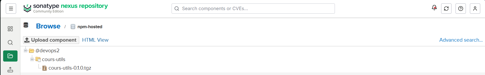
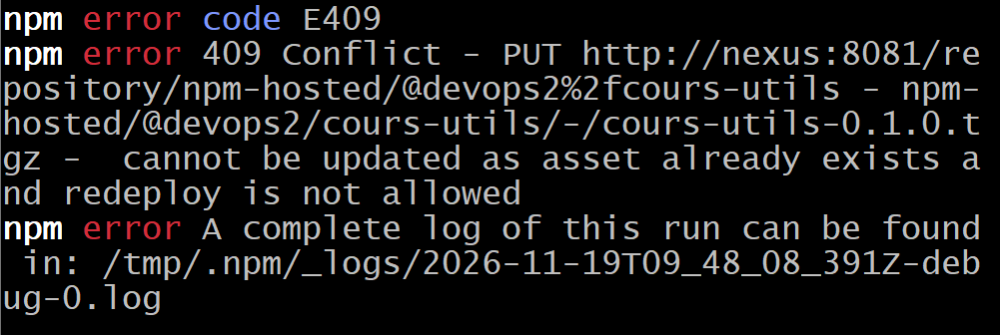
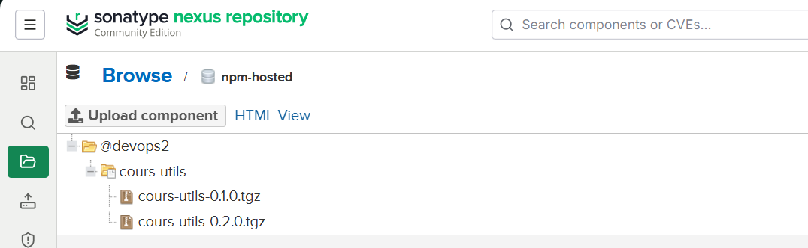
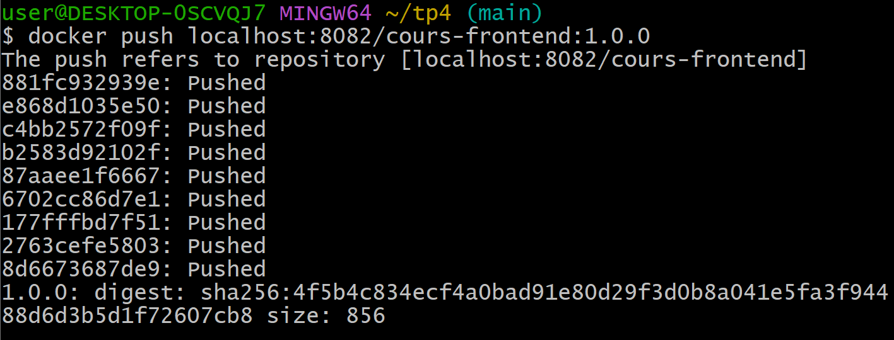

# TP4 — Réponses

**Nom Prénom :** Khlifi Meryem

> Répondez sous chaque question. Si vous avez utilisé `scripts/rattrapage-npm.sh`, indiquez-le ici :

Je n'ai pas utilisé `scripts/rattrapage-npm.sh` : les dépôts npm, le realm, le rôle et l'utilisateur ont été créés à la main dans l'UI.

## Partie 1 — Les dépôts npm

**Q1.** En une phrase chacun : à quoi servent `npm-proxy`, `npm-hosted` et `npm-group` ? Lequel des trois les clients (npm, le build Docker) connaissent-ils ?

- `npm-proxy` : cache de npmjs.org (il télécharge et garde les paquets publics).
- `npm-hosted` : stocke les paquets produits par l'équipe (on y publie).
- `npm-group` : une seule adresse qui regroupe `npm-hosted` et `npm-proxy` (on y lit).

Les clients (npm, build Docker) ne connaissent que **`npm-group`** (`registry=http://nexus:8081/repository/npm-group/`). Seul `npm publish` vise le hosted, via `publishConfig`.

**Q2.** Pourquoi l'ordre des membres de `npm-group` compte-t-il ? Que se passerait-il si un paquet `@devops2/cours-utils` était aussi publié sur npmjs.org ?

Le group interroge ses membres dans l'ordre et renvoie la première réponse. Avec `npm-hosted` en premier, le paquet interne est servi avant tout paquet public de même nom. Si `@devops2/cours-utils` existait aussi sur npmjs.org et que le proxy passait en premier, on risquerait de recevoir la version publique (éventuellement malveillante) à la place de la nôtre : c'est une attaque par confusion de dépendances.

**Q3.** Pourquoi publier avec l'utilisateur `deployer` plutôt qu'avec `admin` ? Pourquoi active-t-on la lecture anonyme ?

Principe du moindre privilège : `deployer` ne peut qu'ajouter/éditer dans `npm-hosted` (et lire), alors qu'`admin` peut tout faire. Si le jeton de `deployer` fuit, les dégâts sont limités. La lecture anonyme évite de distribuer des identifiants pour simplement télécharger : les builds et les postes de développeurs lisent sans secret, seule l'écriture est protégée.

## Partie 2 — Consommer via le group

**Q4.** Après le `npm ci`, que contient `npm-proxy` ? Pourquoi le `package-lock.json` n'a-t-il pas changé alors que les paquets viennent désormais de Nexus ?

`npm-proxy` contient les paquets téléchargés (`next`, `react`, `vitest`… et leurs dépendances transitives, 140 paquets au total), mis en cache. Le `package-lock.json` n'a pas changé car les paquets sont les mêmes tarballs (mêmes versions, mêmes empreintes d'intégrité) ; npm remplace seulement l'hôte du registre par défaut par celui configuré dans `.npmrc`, sans modifier le lockfile.

**Q5.** Demain, npmjs.org est indisponible. Que se passe-t-il au prochain `npm ci` du front ? Et pour un paquet que personne n'a encore téléchargé via votre Nexus ?

Le `npm ci` du front réussit : tous ses paquets sont déjà dans le cache de `npm-proxy`, Nexus les sert sans contacter npmjs.org. Pour un paquet jamais demandé, Nexus doit aller le chercher chez npmjs.org : il échoue (erreur 404/502 ou timeout) tant que npmjs.org est indisponible.

**Q6.** Pourquoi `frontend/.npmrc` est-il commité ? Pourquoi le build Docker du front n'a-t-il besoin d'aucun secret ?

Il ne contient que l'URL du registre, aucun secret, et tout le monde (développeurs, build, CI) doit utiliser la même configuration. Le build Docker ne fait que **lire** via le group, qui est en lecture anonyme ; `nexus` y est résolu vers l'hôte grâce à `extra_hosts: nexus:host-gateway`. Aucun identifiant n'est donc nécessaire.

## Partie 3 — Publier un paquet interne

**Q7.** À quoi servent les champs `files` et `publishConfig` ? Que se passerait-il au `npm publish` sans `publishConfig` ?

- `files` : liste blanche de ce qui part dans l'archive publiée (ici `dist` seulement, sans les sources ni les tests).
- `publishConfig.registry` : registre cible de `npm publish`, ici `npm-hosted`.

Sans `publishConfig`, npm publierait vers le registre configuré dans `.npmrc`, c'est-à-dire `npm-group`, qui n'accepte pas les publications : la commande échouerait (et si aucun registre n'était configuré, npm viserait npmjs.org).

**Q8.** Recopiez le message obtenu à la seconde publication de 0.1.0. Pourquoi Nexus refuse-t-il ? Quel problème cela évite-t-il pour ceux qui ont déjà installé 0.1.0 (pensez au lockfile) ?

Message obtenu : `À RECOPIER DEPUIS TON TERMINAL (copie l'erreur npm affichée au second publish de 0.1.0)`

Nexus refuse car `npm-hosted` est en *Disable redeploy* : une version publiée est immuable. Cela évite que le contenu de `0.1.0` change après coup : le lockfile de ceux qui l'ont installée contient l'empreinte d'intégrité de l'archive d'origine, donc une version republiée avec un contenu différent ferait échouer leur `npm ci` (ou, pire, changerait le code sans que personne le voie). Pour corriger, on publie une nouvelle version.

**Q9.** Pourquoi la version 0.2.0, et pas 0.1.1 ni 1.0.0 ?

SemVer `MAJEUR.MINEUR.CORRECTIF` : on a ajouté une **fonctionnalité** (`formatLevel`) **compatible** avec l'existant, donc on incrémente le **MINEUR** (0.1.0 → 0.2.0). `0.1.1` est réservé à une simple correction de bug ; `1.0.0` annoncerait une API stable ou un changement incompatible, ce qui n'est pas le cas.

**Q10.** Quelles versions la plage `^0.2.0` accepte-t-elle ? Si vous publiez 0.2.1 puis 0.3.0, lesquelles le front prendra-t-il au prochain `npm install` ? Et au prochain `npm ci` ?

Pour une version `0.x`, `^0.2.0` accepte `>=0.2.0 <0.3.0` (le chiffre non nul le plus à gauche est figé). Au prochain `npm install`, le front prend **0.2.1** (pas 0.3.0, hors plage). Au prochain `npm ci`, il installe exactement la version du lockfile (**0.2.0**) : `npm ci` ne met jamais le lockfile à jour.

**Q11.** Où se trouve `NPM_AUTH` et pourquoi n'apparaît-il jamais dans Git ? Que faut-il faire si un jeton a été commité par erreur ?

`NPM_AUTH` est dans `.env`, ignoré par Git (`git check-ignore .env` l'affiche). Le `.npmrc` commité ne contient que la référence `${NPM_AUTH}`, que npm remplace à l'exécution par la valeur de l'environnement (transmise par Compose au service `npm`). Si un jeton est commité par erreur : le considérer comme compromis, **changer immédiatement le mot de passe/jeton** dans Nexus et regénérer `NPM_AUTH`, puis nettoyer l'historique (`git filter-repo` ou BFG) en sachant que la suppression seule ne suffit pas, car l'ancienne valeur reste dans l'historique et les copies.

## Partie 4 — L'image Docker

**Q12.** Décomposez `localhost:8082/cours-frontend:1.0.0` (registre, dépôt, tag). Pourquoi pousse-t-on sur le port 8082 et tire-t-on sur le port 8083 ?

- Registre : `localhost:8082` (hôte et port du registre) ;
- dépôt : `cours-frontend` ;
- tag : `1.0.0`.

Le port 8082 est celui de `docker-hosted` (on y écrit) et 8083 celui de `docker-group` (hosted + proxy, on y lit) : même règle que pour npm, on lit via le group et on écrit dans le hosted.

**Q13.** Recopiez le digest obtenu au push et celui obtenu au pull. Sont-ils identiques ? Que garantit le digest que le tag ne garantit pas ?

- Digest au push : `sha256:À_RECOPIER_DU_PUSH`
- Digest au pull : `sha256:À_RECOPIER_DU_PULL`

Deux étapes à automatiser en CI : (1) lancer les tests (`npm test` du paquet et `docker compose run --rm unit` du front) avant toute publication ; (2) construire, taguer et pousser l'image sur `docker-hosted` (et publier le paquet npm avec `npm publish`), avec les identifiants fournis par les secrets de la CI.Ils sont identiques : c'est le même contenu, simplement récupéré via un autre port. Le digest est l'empreinte SHA-256 du manifeste : il identifie un contenu précis et immuable, alors qu'un tag est un pointeur modifiable qui peut être repointé vers une autre image.

L'image `cours-frontend:1.0.0` (le front avec `@devops2/cours-utils`) est **construite une seule fois**, **stockée** dans `docker-hosted` sur Nexus (port 8082), puis **déployée** sans rebuild : le `docker-compose.yml` n'a plus de bloc `build:` et référence `image: localhost:8083/cours-frontend:1.0.0`, tirée via le group (idem pour postgres via `docker-proxy`). Le même artefact peut être lancé partout.

**Q14.** Pourquoi ne publie-t-on jamais une image sous le seul tag `latest` pour la déployer ?

`latest` est mutable et ambigu : on ne sait pas quelle version tourne, deux déploiements à des dates différentes peuvent récupérer des contenus différents, et le retour arrière est impossible. Un tag de version explicite (`1.0.0`), idéalement figé par digest, rend le déploiement reproductible et traçable.

**Q15.** Pourquoi Docker accepte-t-il ici de parler à Nexus en HTTP ? Que faudrait-il pour un Nexus partagé par toute une équipe ?
**Q16.** « Build once, deploy many » : pour l'image du front, qu'est-ce qui est construit une seule fois, où est-ce stocké, et comment le `docker-compose.yml` le déploie-t-il ? Citez deux étapes de ce TP qu'un serveur d'intégration continue (séance 6) devrait automatiser.

